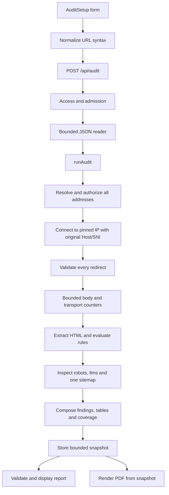

# Website Audit Platform: Engineering Guide

This guide explains how to design, build and reason about the implemented system as a software engineer. Read it alongside the code; it is a description of the system and its tradeoffs, not a transcript of development activity.

## 1. Start with the product's evidence model

An audit is a transformation:

`URL → authorized requests → observed bytes → extracted facts → named checks → evidence report`

These stages answer different questions. A URL parser answers whether an address is well formed. DNS policy answers whether connecting to its destination is allowed. HTTP tells us what one server response contained. HTML parsing tells us which declarations appeared. Rules interpret those observations within a stated scope. None of these steps establishes search rankings or AI citations.

For example, `` is direct evidence that this particular image element lacks an alt attribute. It does not prove that the image is meaningful, that a screen reader cannot obtain context elsewhere, or that the site lost search traffic. The useful output is the element, source page, observation time, recommended review and limits.

The earlier aggregate rubric was removed because weighted pass/fail counts could be mistaken for a validated SEO rating. Version 2 reports evidence and status counts. A pass means the named predicate passed; it does not mean the whole website is healthy. An unavailable check is never converted into zero, a failure or an invented estimate.

## 2. Define scope before choosing infrastructure

The executable scope is one submitted HTML page and three auxiliary resources. It needs a synchronous Node request, bounded collection, parsers and a report. It does not yet need a database, Redis, a crawl worker or generative AI.

The existing application uses Next.js 14, React 18, strict TypeScript and Tailwind 3. A feature directory keeps audit code together while separating browser-safe domain contracts from Node-only networking and PDF dependencies. Cheerio parses response HTML. `ipaddr.js` classifies destinations, `robots-parser` matches declared crawler policy, `fast-xml-parser` validates/parses a bounded sitemap, and PDFKit renders text with local fonts. Playwright tests the application UI; it does not render target websites.

This is a modular monolith: deployment is simple, but each important boundary has a small interface that can later move behind a worker or provider adapter.

## 3. Construction order and why it matters

A reproducible implementation sequence is:

1. Define report/finding/resource types and unavailable semantics. This prevents the UI from inventing assumptions about missing data.
2. Implement pure URL normalization and address policy with adversarial cases.
3. Implement the connector, redirect loop, cancellation and streaming limits. Test against controlled HTTP fixtures before using real sites.
4. Extract observations from saved HTML. Keep network access outside extraction.
5. Write named predicates and explain their limits. Test missing, duplicate, malformed and inapplicable inputs.
6. Add bounded resource collection and parsers without weakening the existing transport boundary.
7. Compose versioned reports and validate the runtime response shape.
8. Build client lifecycle, evidence presentation, filters and explicit unmeasured sections.
9. Retain bounded snapshots and render PDF from those same observations.
10. Verify UI, export, production access and build behavior; document the actual scope.

Each step gives the next one a trustworthy input. Building a polished scorecard before defining evidence semantics reverses that dependency and makes misleading output easy.

## 4. Read the request path

Start at `src/app/audit/page.tsx`, then follow:

The main page finishes before auxiliary resources are requested because redirects determine the final origin. robots.txt and llms.txt are independent and run concurrently. The sitemap request waits for robots because a same-origin sitemap declaration can select its URL. No sitemap entries are automatically crawled.

## 5. Contracts: TypeScript plus runtime validation

TypeScript verifies code during development. It cannot guarantee that JSON returned over HTTP has the shape a component expects. `isAuditReport` therefore checks the response at runtime before state becomes `done`.

`AuditReport` contains two versions. `schemaVersion` identifies structural compatibility; `ruleSetVersion` identifies the meaning of rules. Changing a predicate can change a finding even when the page has not changed, so both belong in exported evidence.

`AuditFinding` separates status, severity, assessment, evidence and limitations. Status says what happened to the predicate. Severity suggests work priority. Assessment distinguishes direct observation from a heuristic. Confidence concerns the observation, not a predicted ranking effect.

`EvidenceSection` is a table contract: title, source, method, column names, rows, observed count and notes. The same rows feed React, JSON and PDF. A table view may paginate without changing the underlying report. Sample limits are data, not hidden implementation details.

`ResourceObservation` distinguishes three outcomes:

- Observed: a successful response was collected in the expected content mode.
- Missing: 404/410 was observed at that requested location.
- Unavailable: timeout, blocked destination, unexpected content or another non-success status prevents a reliable observation.

A retrieved sitemap can still have invalid syntax. Retrieval outcome and validation outcome are separate fields/findings, so the report can say “HTTP 200, invalid XML” accurately.

## 6. Normalize input without confusing it with safety

`parseAuditTarget` defaults a bare domain to HTTPS, rejects unsupported schemes, credentials, nonstandard ports, direct IP input, malformed hostnames and control characters, and strips fragments. Fragments are browser document positions and are not sent in HTTP requests.

A syntactically valid public-looking domain can resolve to a private address. The browser's parser cannot authorize server networking. The server repeats validation and then resolves DNS using its own policy. Never replace this with “the regex accepted it.”

## 7. Admit work before spending resources

`authorizeAuditRequest` enforces same-origin requests when an Origin header is present. Production requires a server-configured operator token and compares fixed-length SHA-256 digests with `timingSafeEqual`. Development binds to loopback and uses a localhost guard. This is not a full user/account system.

`AdmissionGate` allows two active operations and ten starts per minute per process. It stores a bounded rolling window and returns an idempotent release callback. Both audit and PDF routes release their slots in `finally`; failures must not permanently consume capacity.

The JSON body reader checks content type, actual streamed bytes and a five-second arrival deadline. Checking Content-Length alone is insufficient because it may be absent or dishonest. JSON is treated as `unknown` until object/string shape is validated.

The complete audit budget is 35 seconds; the browser waits 40 seconds so a server timeout can arrive as a readable error. Cancellation propagates through AbortSignal. Timers bound asynchronous I/O; synchronous parser/PDF work still runs on the Node event loop and is not preemptible by these timers.

## 8. Make the network destination explicit

The SSRF risk comes from letting user-controlled addresses cause server requests to internal services. The transport follows these steps for every request hop:

1. Validate scheme, credentials, hostname, port and URL length.
2. Resolve A and AAAA records with cancellation and bounded DNS timeout.
3. Reject the whole destination if any answer is private, loopback, link-local, multicast, mapped/transition or another excluded special-use range. Missing DNS is an error.
4. Choose an approved numeric address, preferring IPv4 if available.
5. Connect directly to that address while retaining the original hostname in HTTP Host and TLS SNI. Keep certificate verification enabled.
6. Check that the socket remote address matches the approved address.
7. Follow a supported redirect only after repeating all checks for its destination.

Resolving once and then calling ordinary fetch with the hostname can allow a second DNS lookup to return a different address. Pinning closes that particular validation/connection gap. Redirects are new destinations; an initially safe URL does not authorize its next Location header.

No browser cookies, user credentials or target authentication are forwarded. No arbitrary proxy environment is used. Network egress controls are still required for public deployment; repository code cannot establish the infrastructure boundary by itself.

## 9. Bound responses before parsing them

Main-page collection allows HTML/XHTML, 2 MiB encoded and decoded bytes, five redirects and 15 seconds across DNS/hops. Auxiliary text/XML modes retain the same network policy with 512 KiB, two redirects and four seconds each.

The connector streams the response through an encoded limit, optional gzip/deflate/Brotli decoder, decoded limit and collector. Both limits matter: a small compressed response can expand into a large document. Unsupported encodings and unexpected media types fail explicitly. A truncated body is not silently presented as complete evidence.

Non-2xx bodies are discarded. An access-denied HTML page is not analyzed as the intended page's title, content or schema. The status remains useful evidence, while content checks become unavailable.

The connector measures final-hop header time, total request-through-body time, encoded bytes and decoded bytes. DNS and previous redirects are outside those clocks. Assets are not downloaded. Calling these numbers “page load,” “LCP” or “total website size” would be incorrect.

## 10. Extract first; interpret second

`extract-page.ts` supplies the base rules. `detailed-evidence.ts` supplies bounded inventories and two extra checks. Both parse bytes and perform no network requests. The page's charset is respected where declared; Cheerio decodes entities and normalizes the DOM without executing scripts.

Relative URLs resolve against the document's base URL. A canonical, image URL or script URL is recorded as data, never automatically fetched. Evidence cells are plain strings. React escapes them; PDFKit writes them as text. A target's `<script>` cannot become application code through an evidence table.

Selectors use tag names and nth-of-type ancestry so an engineer can locate an element in the parsed HTML. Browser hydration can change that tree; these are static selectors, not proof of rendered layout.

Complete element counts are retained for headings, images, links, form controls and video/iframe elements. Detailed queries inspect at most 200 matches; JSON-LD parses at most 100 blocks. Tables retain 200 rows and 2,048 characters per cell. Other sections count matching sampled records. Basic rules have their separately disclosed 2,000-image/link and 500-heading caps. A UI count must always be read with its sample boundary.

## 11. Design useful rules without claiming too much

A rule should answer one concrete question. “Does the title exist?” has a clear predicate. “Will this title rank?” needs evidence this system does not have.

Examples:

- No title: fail, with observed absence and a page-specific title recommendation.
- More than one H1: warning labeled heuristic; this is an organization review, not a ranking penalty.
- Empty image alt: attribute exists, so the presence rule passes; decorative intent still needs human review.
- Width/height missing: warning, because CSS may reserve space. CLS remains unmeasured.
- noindex present: warning to verify intent, not an instruction to remove every exclusion.
- Valid JSON-LD syntax: pass for JSON syntax only. It does not establish vocabulary validity or rich-result eligibility.
- Form with aria-labelledby: declaration observed; references and the computed accessible name are not fully evaluated.

Avoid turning a shared cause into multiple independent priorities. An unnamed image link caused by missing alt points back to the image finding. Status counts summarize the implemented predicates; they are not weights or percentages of website quality.

## 12. Crawler files are policy evidence

robots.txt is fetched at the final origin. The parser evaluates the exact audited URL for named bots, recording allowed/disallowed/unknown and matching source line. A robots redirect does not change the origin to which that policy is applied.

Missing 404/410 is informational. A timeout, server error or HTML fallback is unavailable. Do not claim Googlebot was observed visiting the page; the report only evaluated its declared policy. AI crawler directives likewise do not establish model training or citations.

The first usable same-origin sitemap declaration is selected; otherwise `/sitemap.xml` is tried. XML must be well formed and contain a populated urlset or sitemapindex. DTD/entity declarations are rejected, entity expansion is disabled, and location syntax is checked. No child sitemap or page is fetched. Index membership therefore cannot establish whether the audited page appears in its descendants.

llms.txt is optional text/Markdown. Its presence or absence is informational, without a ranking penalty or visibility claim.

Useful source references are [Google's robots.txt creation guide](https://developers.google.com/crawling/docs/robots-txt/create-robots-txt), [the robots-parser API](https://github.com/samclarke/robots-parser#readme), and [Google's sitemap guide](https://developers.google.com/search/docs/crawling-indexing/sitemaps/build-sitemap). These support the file/policy concepts; the implementation's particular budgets and sampling limits are local design choices.

## 13. The UI is a state machine

`AuditSetup` has idle, running, error and done states. The active AbortController prevents duplicate submissions and is cancelled on unmount. Editing the target clears the prior result so it cannot be mistaken for the new URL's report. Cancellation/late responses must not restore obsolete results.

The result view starts with the audited URL, time and finding counts. It shows priorities and expandable evidence, then inventory tables and explicit unmeasured capabilities. Filtering changes presentation, not the recorded observations. Tables scroll within their containers on mobile and paginate collected rows.

Downloads use the existing snapshot. The operator token stays in memory and is sent in a header, never in a download URL. A missing/expired PDF snapshot produces a readable error and leaves the browser's report/JSON intact.

## 14. Export the same evidence safely

The server stores up to ten UUID-keyed reports for fifteen minutes, rejecting serialized reports above 5 MiB. This is temporary retention for export, not database history. Eviction, restart or a different server instance can invalidate an ID.

The PDF route applies the same access policy and admission limit. It accepts an ID, never uploaded HTML or arbitrary client-supplied findings. PDFKit uses a trusted layout and local bundled fonts. It does not navigate to a target or load remote images/fonts. See [PDFKit text/font documentation](https://pdfkit.org/docs/text.html) for the library's text layout mechanism.

Findings and source notes are retained; PDF inventories are limited to 60 rows per section and 500 characters per cell, labeled in the document. JSON contains every collected report row, with the original collection caps. Neither format claims to contain uncollected data. Font coverage and semantic PDF accessibility remain limited and should be tested for the languages required by a deployment.

## 15. Test boundaries with controlled evidence

Use saved HTML and fake transport responses to prove specific behavior without repeatedly crawling third-party sites. The fetcher/resolver/connector seams are injectable from test code only; they are not API flags or environment safety bypasses.

| Layer | Important cases |
| --- | --- |
| URL/address policy | Encoded IPs, private/mixed DNS answers, scoped/mapped IPv6, unsafe protocols and credentials |
| Transport | Original Host/SNI, numeric pinning, revalidated redirects, loops, deadlines, slow streams, compression bombs and content modes |
| Extraction/rules | Exact declarations, missing attributes, duplicate elements, non-2xx documents, malformed JSON-LD, bounded inventories |
| Resources | Bot path matching, source lines, 404 vs 503, HTML fallbacks, malicious XML, cross-origin sitemap declarations and no recursion |
| API | Body size/deadline, token/origin, rate limits, release after failure, safe errors |
| Exports | Snapshot expiry/eviction, actual PDF bytes, source text inspection and no network calls while rendering |
| Browser | Real report shape from fixtures, filters, tables, mobile width, cancellation, retries and download failures |

Run `npm run check`, then browser tests with the dev app running. Stop dev before a production build because both write `.next`. A live audit is a smoke check of current network behavior, not a deterministic regression test. Keep timestamps and avoid turning a one-time result into a permanent claim about a site.

## 16. Debug at the failing boundary

| Symptom | Inspect first |
| --- | --- |
| Format accepted but fetch failed | DNS, destination policy, TLS and target bot protection |
| API disabled in production | Server-only token configuration and authorization header |
| Page succeeds but robots is unknown | Resource status/content type/deadline; do not assume policy permission |
| Sitemap HTTP 200 but warning | XML structure, invalid locations or fallback content |
| Browser content absent from report | Static response versus JavaScript-rendered content |
| Inventory shorter than element count | Declared query/row limits and table pagination |
| “Pass” seems too broad | Exact predicate, assessment and limitations; no whole-site implication |
| Performance differs from browser tools | Different measurement source, clock boundaries and asset coverage |
| PDF expired | Snapshot TTL, eviction, restart or instance routing |
| PDF font/layout failure | Bundled font paths, deployment assets and supported glyphs |
| Missing rankings or AI visibility | No provider/observation source; static markup cannot supply those values |

## 17. Extend through evidence adapters

A browser or PageSpeed adapter should return measured metrics with source, strategy/device, timestamp and explicit unavailable outcomes. Keep lab and field data distinct. Verify current provider policy, quotas and cost before calling it. Do not rescale unrelated HTML predicates into a substitute performance score.

A crawl queue needs an origin/depth/page budget, visited-key normalization, robots policy, cancellation and per-URL evidence. Duplicate content and broken-link claims require multiple actual responses. An orphan-page claim needs a reference inventory beyond discovered links.

Durable history needs accounts, ownership and retention. Multiple application instances need shared snapshots and admission limits. Long-running browser/crawl jobs may justify workers and idempotent job records. Infrastructure follows the required behavior; it should not be introduced just because the project brief names a technology.

The guiding invariant is simple: every displayed measurement must have a source, every inference must be labeled, and missing evidence must remain visible.
